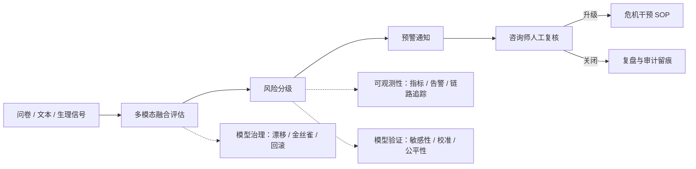

# 心理健康风险评估系统（DWS）

一个面向高校场景的心理健康筛查与预警平台。项目围绕问卷、文本与生理信号的多模态风险评估展开，并补齐了异步任务、实时告警、模型治理、可观测性与安全合规等工程能力，适合作为“AI + 全栈 + DevOps”综合型个人作品集展示。

[架构文档](docs/architecture.md) · [评估可信度一页摘要](docs/EVALUATION_TRUST_SUMMARY.md) · [审计报告](docs/FULL_AUDIT_REPORT.md) · [部署指南](docs/DEPLOYMENT_GUIDE.md) · [变更日志](CHANGELOG.md) · [Issues](https://github.com/kajykk/bysj/issues)

[](https://www.python.org/)
[](https://fastapi.tiangolo.com/)
[](https://vuejs.org/)
[](https://www.postgresql.org/)
[](https://redis.io/)
[](https://prometheus.io/)
[](docs/architecture.md)
[](backend/tests)

---

## 60 秒概览

**是什么**：面向高校场景的多模态心理健康风险评估系统。问卷、文本、生理三类信号汇成一次评估，
输出风险等级，再走「预警 → 咨询师复核 → 危机升级 → 复盘」的闭环；学生 / 咨询师 / 管理员三套工作台。

**难在哪**：这类系统最危险的不是"模型不够准"，而是"**指标很好看但不成立**"——
评估口径泄漏、故障被静默吞掉、新加的鉴权入口绕过租户封禁，这三件事**都不会报错**，
只会安静地给出乐观结果。项目很大一部分工作量，花在把这三件事变成机器可检的不变式上。

**怎么证明**：下面四个亮点各配一个可复现数字。`backend/tests/tools/check_portfolio_numbers.py`
会把本文的数字与仓库内产物逐条比对——**写错一个数字它就红**（CI 同跑）。

| # | 亮点 | 可验证数字 | 怎么复现 |
|---|---|---|---|
| 1 | 完整闭环，不是 Demo 页面 | 运行时 **206** 个 REST 端点 + **3** 个 WebSocket 长连接、**39** 张数据表 | `cd backend && python tests/tools/check_portfolio_numbers.py --show` |
| 2 | 评估可信度治理 | **41 个交付脚本 / 90 处划分与挑优调用点**，逐条人工读码裁定；文本模态泛化口径 **F1 0.5864**（同一模型随机划分 0.9964） | `cd backend && python tests/tools/leakage_audit_scan.py` |
| 3 | 静默降级全部裁定 | **341 处 except 候选**全部裁定：已接线 109 / 真降级留档 116 / fail-closed 8 | `cd backend && pytest tests/test_p2_11_round11.py -k batch6_bucket_counts` |
| 4 | 认证入口机器可检 | **8 个 token 操作入口**（6 强制 + 2 显式豁免）AST 全等覆盖，变异 3/3 红 | `cd backend && pytest tests/test_p2_41_round17_auth_gate.py` |

### 一次评估的流向



### 最短跑起来

```bash
docker run -d --name bysj-redis -p 6379:6379 redis:7-alpine   # 后端测试依赖本地 Redis
cd backend && python -m venv .venv && .venv\Scripts\activate && pip install -r requirements.txt
.venv\Scripts\python.exe -m uvicorn app.main:app --reload      # API 文档 http://localhost:8000/docs
cd ../frontend && npm install && npm run dev                   # 前端 http://localhost:5173
```

账号需先注入 `E2E_ADMIN_PASSWORD` / `E2E_COUNSELOR_PASSWORD` / `E2E_USER_PASSWORD`（见[默认账号](#默认账号)）；
完整步骤见[部署指南](docs/DEPLOYMENT_GUIDE.md)。

### 一条命令跑通「审计 → 闸门 → 变异见证」

```bash
cd backend && python tests/tools/portfolio_demo.py
```

预期输出（2026-10-20 实跑，约 85 秒）：

```text
[1/3] 审计  git ls-files + AST 扫描 ML 划分/挑优入口 ...
      → 41 个交付脚本 / 90 处调用点（口径：排除 tests/，只认 git 跟踪文件）
      OK
[2/3] 闸门  泄漏守卫 + 鉴权入口 + 文档数字自检 ...
      → 29 passed, 43 warnings in 39.29s
      OK
[3/3] 变异  清空 LABEL_DERIVED_FEATURES（L4 目标泄漏登记表）...
      → 变异后：2 failed, 5 passed, 4 warnings in 5.02s
      RED（符合预期）
      → 还原：字节一致
      → 还原后：7 passed, 4 warnings in 4.91s
      OK
--------------------------------------------------------------------
DEMO OK（三步全部符合预期）
```

这条脚本演示的是本项目的核心方法论：**审计给出事实 → 闸门把事实钉死 → 变异证明闸门真的会红**。

### 文档索引

| 想了解什么 | 看哪份 |
|---|---|
| 系统架构与模块划分 | [docs/architecture.md](docs/architecture.md) |
| 模型数字在什么条件下才算数 | [评估可信度一页摘要](docs/EVALUATION_TRUST_SUMMARY.md) → [完整报告](docs/EVALUATION_INTEGRITY_REPORT.md) |
| 泄漏怎么发现、怎么量化 | [泄漏审计](docs/ML_LEAKAGE_AUDIT.md) · [补救与闸门](docs/ML_LEAKAGE_REMEDIATION.md) |
| 概率准不准、用在哪个阈值有净收益 | [校准与决策曲线](docs/model-evaluation/CALIBRATION_REPORT.md) → [台账 C-26~C-33](docs/thesis/CLAIMS_LEDGER.md) |
| 漏报能不能压下去、代价是什么 | [漏报安全网评估](docs/model-evaluation/SAFETY_NET_REPORT.md) → [台账 C-34~C-38](docs/thesis/CLAIMS_LEDGER.md) |
| 缺一个模态时风险等级会跳几级 | [融合层模态消融](docs/model-evaluation/FUSION_ABLATION_REPORT.md) → [台账 X-07~X-09](docs/thesis/CLAIMS_LEDGER.md) |
| 阴性结论长什么样 | [纵向早期检测（阴性）](docs/planning/P2_R15_EARLY_DETECTION_RESULT.md) |
| 临床 / 注册准入差距 | [临床准入差距分析](docs/planning/P2_R15_CLINICAL_READINESS.md) |
| 全量审计与历史整改 | [FULL_AUDIT_REPORT](docs/FULL_AUDIT_REPORT.md) · [CHANGELOG](CHANGELOG.md) |
| 部署与运维 | [部署指南](docs/DEPLOYMENT_GUIDE.md) · [应急手册](docs/EMERGENCY_RUNBOOK.md) |

## 适合谁

- 需要做心理健康筛查、风险预警或干预管理的高校/机构
- 想看一个“AI + 全栈 + DevOps + 可观测性”完整落地样例的人
- 希望快速了解 FastAPI + Vue 3 + Celery + Redis + PostgreSQL 组合实践，并参考作品集表达方式的人
- 找求职作品集 / 项目答辩材料 / 系统设计案例的人（可先读上面的 60 秒概览）

## 核心功能

- 用户、咨询师、管理员三角色工作台
- 风险评估、预警监控、报告导出与复盘闭环
- 异步任务调度、定时任务与告警处理
- 模型训练、实验、发布、回滚和状态管理
- 监控、告警、审计日志与运行状态可视化

## 为什么这个项目值得看

- 不是只有页面展示，而是把“筛查—预警—干预—复盘”流程做成了完整闭环
- 不只是调用模型，还考虑了回退策略、漂移检测、金丝雀发布与回滚
- 不只是开发功能，还把测试、监控、审计、部署和安全一并纳入交付范围
- 不只报指标，还审计了指标**什么时候不成立**，并把发现固化成闸门

## 技术栈

### 后端
- Python 3.12 · FastAPI · SQLAlchemy 2.0 · Pydantic 2
- PostgreSQL 15 / SQLite · Redis 7 · Celery 5.4 · Alembic
- scikit-learn · PyTorch（可选）· Transformers · NumPy / Pandas
- 多租户、审计、内容治理、告警与监控相关服务

### 前端
- Vue 3.5 · TypeScript 5.6 · Vite 6
- Element Plus · ECharts · Pinia · Vue Router
- Vitest · Playwright · Lighthouse CI

### 工程化
- Docker / docker-compose
- GitHub Actions
- Ruff · mypy · ESLint · Prettier · Codecov

## 快速开始

### 本地开发

```bash
git clone https://github.com/kajykk/bysj.git
cd bysj

# 后端
cd backend
python -m venv .venv
.venv\Scripts\activate  # Windows
# source .venv/bin/activate  # Linux / Mac
pip install -r requirements.txt
cp .env.example .env
uvicorn app.main:app --reload

# 前端（新开终端）
cd frontend
npm install
npm run dev
```

- 后端地址：`http://localhost:8000`
- API 文档：`http://localhost:8000/docs`
- 前端地址：`http://localhost:5173`

### Docker 启动

```bash
docker-compose up -d
```

- 前端：`http://localhost:8080`
- 后端：`http://localhost:8000`
- Grafana：`http://localhost:3000`
- Prometheus：`http://localhost:9090`

## 默认账号

系统账号由后端 seed 机制在初始化时创建，**仓库不预置任何可直接使用的口令**：seed 流程要求显式注入下列环境变量，缺失时会拒绝创建账号，而不是回落到内置默认值。`scripts/` 下的运维辅助脚本同样只从环境变量 / `.env` 读取凭据，不提供内置默认值。

首次启动前，必须在 `.env` 中配置以下环境变量（口令长度 ≥ 18 位）：

- `E2E_ADMIN_PASSWORD`（管理员）
- `E2E_COUNSELOR_PASSWORD`(咨询师)
- `E2E_USER_PASSWORD`（普通用户）

未配置时 seed 流程会拒绝创建账号并给出提示。生产环境请通过 `.env` 注入独立强口令，不要复用任何示例值。

> 生产 compose 编排中 `ENABLE_SEED` 默认为 `false`；如需重建种子账号，请显式开启并完成后再关闭。

## 测试

### 后端前置条件

- **Redis**：后端测试依赖本地 Redis（`redis://localhost:6379`）。未启动时会因连接重试/退避导致 pytest 挂起：

  ```bash
  docker run -d --name bysj-redis -p 6379:6379 redis:7-alpine   # 之后用 docker start bysj-redis
  ```

- **离线环境**：本机无法访问 HuggingFace 时，文本模型相关用例会因 `from_pretrained` 超时阻塞，运行前需设置：

  ```powershell
  $env:HF_HUB_OFFLINE="1"; $env:TRANSFORMERS_OFFLINE="1"
  ```

  > **2026-10-04 现状补充**：① BERT 权重已下线归档（`models/_archive/bert_text_classifier_20261004/`），
  > 残留的 BERT 脚本/用例仅作历史参考，**主路径是双语 TF-IDF + LR**；
  > ② 本机访问 HuggingFace 需走镜像（`HF_ENDPOINT=https://hf-mirror.com`），
  > 大模型权重用 `scripts/fetch_hf_model_via_mirror.sh` 断线续传（直连每次只到约 5.7MB）；
  > ③ `sentence-transformers` 在本环境（transformers 5.5.0）**不可用**——它会调 5.x 新增的
  > `AutoProcessor`，而 2023 年的句向量模型仓库没有 processor 配置会直接 `ValueError`，
  > 改用手工 `AutoTokenizer` + `AutoModel` + mean pooling（见 `scripts/t1_sentence_embedding_eval.py`）。

### 运行

```bash
cd backend
pytest -v

cd frontend
npm test
npm run test:e2e
npm run lighthouse:ci
```

### Grafana E2E（tests/e2e/test_grafana_e2e.py）

需对接运行中的 Grafana 与后端实例（默认 `localhost:3000` / `localhost:8000`）。本机 8000 端口被其他项目容器占用时，指向 dws 后端（本仓库容器在 8001），并注入凭证：

```powershell
$env:GRAFANA_PASSWORD="<Grafana admin 密码，区别于容器默认 admin/admin>"
$env:BACKEND_URL="http://localhost:8001"
$env:GRAFANA_SA_TOKEN="<从 Grafana API Keys 或 dws-backend 容器环境变量 GRAFANA_SERVICE_TOKEN 获取>"
python -m pytest tests/e2e/test_grafana_e2e.py -v
```

## 项目规模与成果

这个项目由我个人主导完成，AI 负责加速需求拆解、代码生成、测试补齐和文档整理，我负责架构判断、实现确认、联调修正和最终验收。

基于当前仓库内容，项目已经覆盖：

- FastAPI 后端与 Vue 3 前端完整联动
- 多模态风险评估、文本分析与生理信号处理
- 预警、静默、升级、导出和审计相关流程
- 模型训练、评估、回滚、漂移监控与金丝雀发布
- 可观测性、告警联动和仪表盘配置
- 大量单元、集成、契约、E2E 与稳定性测试

已知规模数据（**2026-10-20 重新实测**；括号里是复算口径，`backend/tests/tools/check_portfolio_numbers.py` 会逐项核对）：

- 49 个 API 路由文件（`backend/app/api/**/*.py`）
- 66 个业务服务文件（`backend/app/services/**/*.py`）
- 71 个核心模块文件（`backend/app/core/**/*.py`）
- 29 个 ML 模块文件（`backend/app/ml/**/*.py`）
- 39 张数据表声明（AST 统计 `__tablename__`）
- 运行时 206 个 REST 端点 + 3 个 WebSocket（**独立解释器**里 import 一次 `app.main`，沿 include 标记递归展开后数**有效路由**；进程内数会受测试会话的模块装载顺序影响，fastapi ≥ 0.151 的 `include_router` 也不再扁平化 `app.routes`，两版依赖下展开读数同为 206/3，2026-10-21 实测见 `docs/P2_22_ROUND22_PORTFOLIO_AUDIT.md` §八）
- 9 个 Docker 服务（`docker-compose.yml`）
- 契约测试全部通过
- 7,657 例后端测试 / 1,327 例前端测试（`cd backend && pytest --collect-only -q`；
  `cd frontend && npx vitest list | wc -l`。**这两项每次提交都会变，仅作快照，不入数字闸门**）

> 上一版这里写的是 2026-09-23 的读数（50 路由 / 191 端点 / 62 服务 / 61 核心 / 27 ML / 6,160 后端用例 + 1,119 前端用例）。
> 本轮逐项重测后按实测值更新：端点 191→206、服务 62→66、ML 27→29、后端用例 6,160→7,455；其余口径也已写进括号，不再留"某处曾测过"的模糊数字。

> ROUND_25（2026-10-22）校准：后端用例 7,455→**7,548**（`pytest --collect-only -q` 实测）。
> 该数自 ROUND_22（2948428）后 ROUND_23/23b/24 各批未随提交更新，本轮一次性校准；
> 增量含各批新增（ROUND_23a M13 唯一索引闸门、23b 前端越权与秘密扫描、24 分页闸门、
> 25 记账闸门与判据自证）。前端 1,327 为 ROUND_22 快照，本轮无前端改动、未重测。

> ROUND_28（2026-10-23）校准：后端用例 7,548→**7,552**（`pytest --collect-only -q` 实测），
> 增量全部来自 `tests/test_p2_55_round28_thesis_numbers.py`（论文数字校验闸门接入：4 例）。
> 前端 1,327 仍为 ROUND_22 快照，本轮无前端改动、未重测。

> ROUND_29（2026-10-23）校准：后端用例 7,552→**7,557**（`pytest --collect-only -q` 实测），
> 增量全部来自 `tests/test_p2_56_round29_scaler_consistency.py`（D-R26-1 修复后的
> scaler 一致性闸门：5 例）。前端 1,327 仍为 ROUND_22 快照，本轮无前端改动、未重测。

> ROUND_33（2026-10-24）校准：后端用例 7,557→**7,582**（`pytest --collect-only -q` 实测）。
> 差额 25 = 本轮 `tests/test_p2_59_round33_calibration.py`（校准/DCA 分析闸门：16 例）
> + ROUND_30/31 的 `test_p2_57`/`test_p2_58` 共 9 例（该两轮未在 README 登记增量，此处一并归属）。
> 前端 1,327 仍为 ROUND_22 快照，本轮无前端改动、未重测。

> ROUND_35（2026-10-24）校准：后端用例 7,582→**7,620**（`pytest --collect-only -q` 实测）。
> 差额 38 = ROUND_36/37 的 `test_p2_60`（19 例）+ `test_p2_61`（18 例）+ 本轮
> `test_p2_58` 新增的 EATD 数据未跟踪断言（1 例）。前端 1,327 仍为 ROUND_22 快照，
> 本轮无前端改动、未重测。

> ROUND_38（2026-10-24）校准：后端用例 7,620→**7,642**（`pytest --collect-only -q` 实测），
> 增量全部来自 `tests/test_p2_62_round38_order_determinism.py`（排序确定性闸门：22 例）。
> 前端 1,327 仍为 ROUND_22 快照，本轮无前端改动、未重测。

> ROUND_39（2026-10-24）校准：后端用例 7,642→**7,657**（`pytest --collect-only -q` 实测），
> 增量全部来自 `tests/test_p2_63_round39_startup_truthfulness.py`（启动自检真实性闸门：15 例）。
> 前端 1,327 仍为 ROUND_22 快照，本轮无前端改动、未重测。

如果你只想快速了解项目，建议优先看：架构文档、审计报告和部署指南。

## 目录结构

```text
bysj/
├── backend/      # FastAPI 后端
├── frontend/     # Vue 3 前端
├── docs/         # 架构与审计文档
├── common/       # 跨端共享资源
├── scripts/      # 运维脚本
├── infra/        # 基础设施配置
├── monitoring/   # 监控配置
├── .github/      # CI/CD 工作流
├── docker-compose.yml
└── README.md
```

## 配置要点

复制 `.env.example` 为 `.env` 后，至少需要配置：

- `DATABASE_URL`
- `REDIS_URL`
- `JWT_SECRET_KEY`
- `PII_ENCRYPTION_KEY`
- `VITE_API_BASE_URL`

此外，仓库还包含后端、前端和基础设施的独立配置文件，适合按模块逐步启动和验证。

## 作品集素材（问题 → 动作 → 可验证结果）

面向招聘方的四条，每条都能在仓库里复算（数字出处见上面「60 秒概览」，由自检脚本统一核对）：

- **评估泄漏治理**：发现同一批数据"随机划分 F1 0.9964 / 按人分组 0.5864"的落差后，用 AST 把全仓 41 个交付脚本里的 90 处评估入口逐条裁定，量化出 ΔF1 +0.3111 的泄漏红利，并把目标泄漏做成提交期闸门（7 条断言 + 3 个真实变异）。
- **静默降级治理**：把 341 处 except 候选逐条裁定为"已接线 109 / 真降级留档 116 / fail-closed 8"，让"故障被吞掉"从口头保证变成可查询指标 + 提交期棘轮。
- **认证入口覆盖**：用 AST 发现集与登记表全等比对，把 8 个 token 操作入口的租户封禁校验变成结构性不变式——新增入口不登记，CI 直接红。
- **文档钉事实**：写了一个自检脚本，把 README 与摘要里的 21 个关键数字逐条对回仓库产物；改错一个数字，CI 就红（本轮已用 3 处真实变异验证）。

## 作者

**邝振华** · 数据科学与大数据技术 · 湖北商贸学院 · 2026 届

- Email：1754902912@qq.com
- GitHub：[@kajykk](https://github.com/kajykk)
- 求职意向：全栈开发实习生（AI 编程方向）
- 作品定位：个人独立完成的 AI 协作全栈项目作品集

## 说明

本项目的定位是“可运行、可验证、可演示”的个人作品集级完整系统示例。当前 README 侧重于 GitHub 首页展示，更多实现细节请见 `docs/`。

> **版本号说明**：全仓版本数字的唯一权威源为 [`backend/app/core/config.py`](backend/app/core/config.py)
> （`app_version` 与 `RELEASE_CODENAME`）。README 与 docs 不独立维护徽章或版本数字，
> 运行时可通过 `/api/v1/version` 端点查询实际版本。
